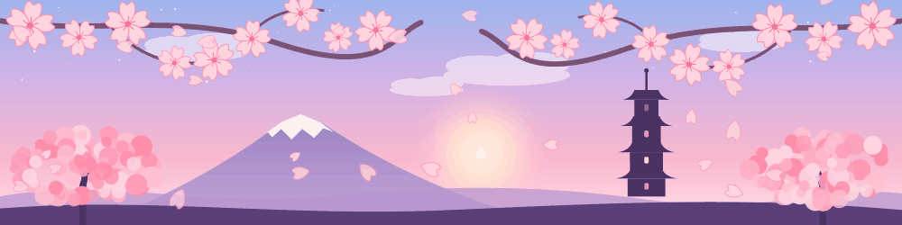

<h2 align="center">🌸 About me 🌸</h2>

<table align="center">
<tr>
<td align="center" width="220">

</td>
<td>

Hi! I'm **Filipa** (everyone calls me **Xiripa** 🎀), a **Computer Science and Engineering** student at **ISEL**. I love building things that work *and* look pretty ✨

🌷 Member of **WIE** (IEEE), **IEEE** and **AEISEL**
🚩 Did a **CTF** bootcamp
📚 I tutor Mathematics A and MACS

</td>
</tr>
</table>

✦ ･ﾟ: *✧･ﾟ:* 　　 *:･ﾟ✧*:･ﾟ✦

<h2 align="center">💻 Tech stack 💻</h2>

**🌸 languages**

**🎀 tools**

**🌱 currently learning**

✦ ･ﾟ: *✧･ﾟ:* 　　 *:･ﾟ✧*:･ﾟ✦

<h2 align="center">🩷 Currently working on 🩷</h2>

| 🌸 project | 🎀 what it is | 🛠️ tech |
|:---:|:---:|:---:|
| **Go** 🎮 | Go game with board, rules and persistence | Kotlin |
| **LabsAPW** 🌐 | Web Architecture and Programming labs | JavaScript |
| **ISI_grupo** 🗄️ | national exams database | SQL |

✦ ･ﾟ: *✧･ﾟ:* 　　 *:･ﾟ✧*:･ﾟ✦

<h2 align="center">📊 GitHub analytics 📊</h2>

<h2 align="center">📈 Contribution graph 📈</h2>

<h2 align="center">🐍 The snake eats my commits 🐍</h2>

✦ ･ﾟ: *✧･ﾟ:* 　　 *:･ﾟ✧*:･ﾟ✦

<h2 align="center">🎧 Fun facts 🎧</h2>

<b>🌸 click to open 🌸</b>

 

🎮 I like games enough to build one (yes, the Go project!) 
🚩 CTFs make me feel like a hacker in a movie 
🎀 Everything I code has to look pretty too 
📚 Explaining maths to others is how I learn it best

<h2 align="center">💌 Let's connect 💌</h2>

*open to collabs, study groups and good music recommendations* 🎶

<h2 align="center">💬 Random dev quote 💬</h2>

